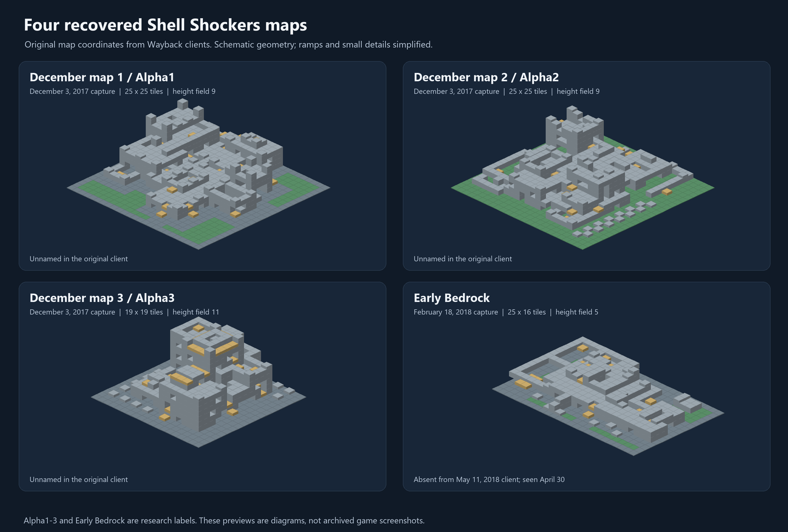

# Recovered maps missing from the May 2019 remake

Investigated November 6, 2026 using Wayback Machine captures, REA 6.8.0, and inert syntax extraction. **Four additional complete map layouts were recovered: three from December 2017 and Early Bedrock from early 2018.** They are now playable as Alpha1, Alpha2, Alpha3 and Early Bedrock, appended after the existing ten maps at indices 10–13.

The baseline is the existing ten-map roster in `research/agent/maps-20190519.json`: Blue, Castle, Dirt, Feedlot, Fort Flip, Moonbase, Ruins, Shipyard, Shellville, and Two Towers.

## Recovered layouts

All four original objects have an empty `name` field. Alpha1–3 and Early Bedrock are research labels, not recovered official names. December labels follow the three objects' array order, consistent with the historical research convention.

| Research label | Footprint; native height field | Direct archive observations | Export |
| --- | --- | --- | --- |
| December map 1 / Alpha1 | 25 × 25; height 9 | Present December 3, 2017; absent from the January 20, 2018 roster | [Native map JSON](../research/maps-before-may2019/maps/dec2017-alpha1.json) |
| December map 2 / Alpha2 | 25 × 25; height 9 | Same captures as Alpha1 | [Native map JSON](../research/maps-before-may2019/maps/dec2017-alpha2.json) |
| December map 3 / Alpha3 | 19 × 19; height 11 | Same captures as Alpha1 | [Native map JSON](../research/maps-before-may2019/maps/dec2017-alpha3.json) |
| Early Bedrock | 25 × 16; height 5 | Present January 20, February 18 and April 30, 2018; absent May 11, 2018 | [Native map JSON](../research/maps-before-may2019/maps/early-bedrock.json) |



These previews use original tile coordinates. They are schematic diagrams with simplified block shapes, ramps and colors; they are not archived screenshots. The research exports preserve the original numeric-category map schema, coordinates, decoration IDs, rotations, dimensions and other fields.

The game build converts these native exports into the May renderer's string-key format using `scripts/historical-maps.mjs`. `public/maps/historical.json` is the shared generated payload used by the client, browser practice and Node server. Tile IDs are corroborated against unchanged Blue/Two Towers cells and the pinned LegacyShell `old-map-converter.js`; stairs, metal ramps, barricades and ladders use their matching original May models. Every recovered position and quarter-turn rotation is preserved. The archived May executable remains unchanged in `archive/`.

The old exports contain no spawn or spatula markers. The conversion reconstructs up to 48 distributed spawn points on solid surfaces with two clear cells above and an inset from map edges, splits them between teams, and chooses a central spawn for the spatula. The default May skybox and sun direction are used. These compatibility choices are recorded in each map's `preservation` metadata and in the game's preservation notes; they are not claimed to be historical server behavior. All three game modes are supported.

## Primary evidence

- [December 2, 2017 HTML, version 0.9.0](https://web.archive.org/web/20171202205033id_/http://shellshock.io:80/) references the exact query used by the following client.
- [December 3, 2017 client](https://web.archive.org/web/20171203032547id_/http://shellshock.io/src/shellshock.min.js?1512201638) contains the three December maps in `minMaps`. File SHA-256: `434dbc8f0da7ddcdb9eabc0c2ac1db0e0c7c981f4ea9f841d1c0b7bddcd904dc`. Literal range: character offsets 85,396–168,168, end exclusive.
- [January 20, 2018 client](https://web.archive.org/web/20180120231822id_/https://shellshock.io/src/shellshock.min.js?1512671884) contains Blue, Early Bedrock and Two Towers. All three have the same serialized map-object hashes as in the February and April captures.
- [February 18, 2018 client](https://web.archive.org/web/20180218182625id_/https://shellshock.io/src/shellshock.min.js?1518900511) supplies the exported Early Bedrock object at index 1. File SHA-256: `d5c92ed67f43972925ea3b11a9232b288bb77c02341bdd2f672dd0d540acbe13`. Map-array literal range: offsets 110,996–163,050.
- [April 30, 2018 client](https://web.archive.org/web/20180430010256id_/https://shellshock.io/src/shellshock.min.js?1524604909) still contains Early Bedrock.
- [May 11, 2018 client](https://web.archive.org/web/20180511182718id_/https://shellshock.io/src/shellshock.min.js?1526056947) instead contains Feedlot, Blue, Two Towers and the original larger Shipyard. The [associated HTML](https://web.archive.org/web/20180511182718id_/https://shellshock.io/) provides the contemporary page.

The archive establishes a roster change between observations, not an exact removal day. Historical research associates the December roster's replacement with January 2018's 0.10.x updates and Early Bedrock's removal with May 2018's 0.13.0 update. The file captures independently support the before/after rosters.

### Timestamp caveats

The [December 30, 2017 HTML](https://web.archive.org/web/20171230150253id_/http://shellshock.io/) says 0.9.2 and references query `1512671884`, but the recovered script for that query is captured January 20, 2018. Its query resembles a December modification timestamp. Neither the query nor the HTML proves that the January-captured bytes were served unchanged in December. Therefore this report does not claim an exact last December play date or exact removal date from that URL.

A November 4, 2017 HTML script link was also probed. Wayback redirected the requested November replay to **May 7, 2018**. Those returned bytes contain Blue, Early Bedrock and Two Towers and cannot prove a November 2017 map roster. Requested and resolved URLs are retained separately in the download metadata.

## Earlier footage-only candidates

The [LegacyShell map-history investigation](https://github.com/onlypuppy7/LegacyShell/blob/a7cbb8dff2685dd024573dd36242d26640ebbcef/wiki/wiki/History/maphistory.md) documents three unnamed 0.7.x layouts and four unnamed 0.8.x layouts from late October–November 2017. These are additional visual candidates, not seven recovered map-data files. Their exact distinction, availability dates and relationship to generated maps remain less certain. One 0.7.x attribution is explicitly tentative.

| Candidate | Footage lead |
| --- | --- |
| 0.7.x #1 | [nicolas rivera](https://www.youtube.com/watch?v=89LagCZwPFY) |
| 0.7.x #2 | [LoadingSomething](https://www.youtube.com/watch?v=FnaKFU-yt1c) |
| 0.7.x #3, uncertain version | [Anny Aurora](https://www.youtube.com/watch?v=ijgDS9Dmi_o) |
| 0.8.x #1 | [noglue](https://www.youtube.com/watch?v=UZSnvnNg8Qk), [ayda](https://www.youtube.com/watch?v=52_qlXHv5so) |
| 0.8.x #2 | [bendthemetal](https://www.youtube.com/watch?v=YSDzwIz_y2Y) |
| 0.8.x #3 | [ByRydan](https://www.youtube.com/watch?v=naOw1IUK0HM) |
| 0.8.x #4 | [ByRydan](https://www.youtube.com/watch?v=2PhtsbCgFkc) |

These footage links come from the historical investigation and its timeline; they were not independently watched during this pass. The map-history document has two apparent mistaken video links: 0.7.x #1 points to an earlier video's ID, and 0.8.x #4 repeats #3. The table uses the matching titles and IDs from the timeline instead.

For recognition, the same research links December Alpha1 to [gameplay at 2:09](https://youtu.be/AYeGbwtRVqg?t=129), Alpha2 to [this compilation](https://www.youtube.com/watch?v=YVrCQR4BQ80), Alpha3 to [New Year's Eve footage at 2:21](https://youtu.be/0Gi4NultfvM?t=141), and Early Bedrock to [gameplay at 5:42](https://youtu.be/xyT6_v7H_vs?t=342). These are corroboration leads; the actual recovered data comes from the primary archived clients above.

Before the map editor, September and early October 2017 also had generated layouts visible in footage. Surviving generator code can make similar maps but cannot establish the original seeds or recreate each original arena exactly. A generated lookalike is not treated as a recovered map.

## REA analysis and extraction

The project's existing REA 6.8.0 installation was executed against isolated copies of the December and February client artifacts. REA analyzed them as inert JavaScript, recovering the map-array bindings and their reads by `createMapCells`. No archived bootstrap or game code was executed.

| Subject | REA Evidence ID | Compact report |
| --- | --- | --- |
| December client | `ev_20f601c47ddec31149f28969f5caf498b65fc2928d4e92ab6bef38c492077299` | [December evidence summary](../research/maps-before-may2019/rea-dec2017.compact.json) |
| February client | `ev_e4c4fa2a787c439eef24d315820743bb4f4b55e02cfdb604861927640422f84f` | [Early-2018 evidence summary](../research/maps-before-may2019/rea-early2018.compact.json) |

REA establishes static artifact structure, not observed live gameplay or historical server selection. Its graph coverage and unresolved relationships remain qualified in the retained evidence. The complete December/February evidence files are retained locally and ignored by Git because of their size.

The first REA attempt encountered a temporary-directory permission error. Setting this process's TEMP/TMP to the existing workspace `tools/rea-temp` allowed parsing to complete. REA's December bundle exporter then failed to write its destination, but returned the completed Evidence record in `details.partial_observation`; that full record was saved directly. February analysis completed successfully through normal CLI JSON output. No installation or system configuration changes were needed.

`extract-maps.mjs` then used Babel's parser and a restricted literal decoder to export `minMaps`, accepting only inert object, array, numeric, string, Boolean and null syntax. It did not use `eval`, a VM or the archived scripts' functions.

Verification covered source SHA-256 against retrieval metadata, exact JSON-object round trips, all 4,672 tile records' coordinate bounds, and comparison with the ten-map baseline. The four recovered layouts each have dimensions absent from that baseline. `recovered-maps.json` records every export hash and source URL.

## Search boundary and remaining uncertainty

The saved 2017–2018 `/src/` CDX index contains 108 successful distinct-digest rows, including 67 client-script rows. Twelve client replays were inspected, spanning December 2017 to December 2018, plus the existing May 2019 client. The misleading November-link replay is included among those twelve and is explicitly dated by its resolved May 2018 response.

Later checked rosters contain four maps in May/June 2018, five in late June, six in July, eight in September, and nine in November/December. Those later additions correspond to maps already in the current ten; older Shipyard and Castle geometry variants are not counted as additional named maps. Fort Flip is already in the May 2019 baseline.

Requests for a full-domain 2017 index and January–April 2019 client index failed with a 503 or timeout; a narrower April query also returned 503. Consequently **four is the number positively recovered in this investigation, not a proof that no other pre-May-2019 experimental or temporary maps ever existed**. No missing November map was substituted with later replay content.

Historical arena promos from late 2018 also exist, but promotional visibility does not establish that those arenas were playable in the public game before May 2019. They are excluded from the confirmed list.

To repeat local extraction and export, with the retained clients and REA installation present:

```powershell
node research/maps-before-may2019/extract-maps.mjs
python research/maps-before-may2019/prepare-findings.py
```

Acquisition manifests, per-file URL/hash metadata, full extracted snapshot rosters, the map inventory, compact REA evidence and the four single-map exports are under `research/maps-before-may2019/`.
