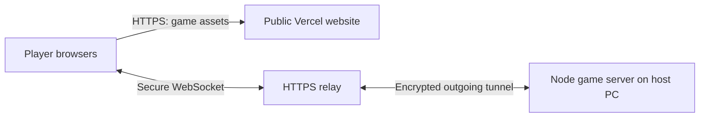

# Public website, private source, local multiplayer

- Public browser game: https://old-shell-shockers-remake.vercel.app
- Private source repository: https://github.com/ctrl-pt/old-shell-shockers-remake
- Maximum players per hosting session: 10 people, including the host.



Vercel serves browser files. The authoritative movement, damage, players and rooms run on the host PC. Opening a website cannot launch arbitrary programs on a computer: **Host Game.bat** is the explicit start action. No startup service or scheduled task is installed.

## Start and stop

Install Node.js 22 or newer. Double-click `Host Game.bat`; it installs the project's npm dependencies if missing, binds the game server to `127.0.0.1:31415`, creates an anonymous localhost.run SSH tunnel, and opens the configured public website with a secure backend URL. Share that session URL with friends. A fresh URL is generated each session.

The default link starts Free For All. Players using the same mode enter the same public room. To choose a particular map or mode, create a private room in the game and use its Invite friends button. Room IDs and keys are padded to the original six-character format, and the invite preserves the secure backend address and session key.

Leave the hosting window open and keep the PC awake. Stop with Ctrl+C or `Stop Hosting.bat`. The stop launcher authenticates to a separate loopback-only management port, which the public tunnel does not expose. It ends both the game server and relay. Closing a browser tab does not stop hosting.

Guests only need a modern desktop browser. They do not install this project, run a server, or sign into GitHub, Vercel, or the relay provider. The bare public URL runs practice; it does not discover the host's latest temporary address. Share the actual session or in-game invitation link for multiplayer.

## Local configuration

`host.config.json` holds the public website URL and relay choice. It contains no secrets. Terminal equivalents:

```powershell
npm run host
npm run host:stop
node scripts/host-game.mjs --no-open
node scripts/host-game.mjs --port 31416
```

The game binds to loopback and only serves files from `public/`. Each session uses a new random access key required for WebSocket upgrades. A separate local-only key protects the stop control. Both remain in `.host/session.json`, excluded from Git and deployment, together with logs and the relay's known-hosts file. The Node SSH client uses anonymous `nokey` authentication and does not offer personal SSH keys or use the SSH agent. The relay host key is pinned on first connection and checked on later connections. No router or firewall configuration is changed.

An alternative Cloudflare Quick Tunnel is available with `--tunnel cloudflare`. The first use downloads the official Windows x64 cloudflared 2026.10.7 executable and verifies SHA-256 `2493dbc168923bb3e59e5e7716f71deced92992eea9acd6e9d74f84ac7751343` before execution. Other platforms can supply `CLOUDFLARED_PATH`. Cloudflare's quick-tunnel API timed out from this PC during setup, so localhost.run is the working default.

Free relay names are temporary and provider uptime is outside this project. For a permanent backend hostname, use a named tunnel or custom-domain relay and configure its `wss://` address in the game's preservation notes. The PC must remain running in either case.

## Private GitHub and manual Vercel publishing

The repository is private. Vercel is not connected to it: the owner chose static-file publication instead of granting GitHub repository access. Normal Git commits and pushes preserve incremental development history.

```powershell
npm run deploy:prepare
npm exec --yes --package vercel@65.12.1 -- vercel deploy --prebuilt --prod --yes
```

`deploy:prepare` rebuilds the client, runs tests and copies only `dist/` into the Vercel Build Output API static directory. There are no deployed server functions. Private source, archive files, research, hosting credentials, `.env` files and local tools are excluded from that upload. Browser JavaScript and assets remain downloadable as with any public browser game.

The relay adapter pins `ssh2` 1.17.0 and includes a narrow compatibility shim for localhost.run's shell banner: that server streams data without acknowledging the shell request, so the adapter sends the shell request without waiting for a reply. Authentication, encryption and host-key verification remain active. The built-in Windows OpenSSH client disconnected under the concurrent WebSocket test; the Node adapter passed the ten-player internet test.

## Verification

`npm test` checks original asset integrity and gameplay, all fourteen maps, fixed-width invitation codes and ten actual WebSocket clients joining and spawning in one room. It verifies that an eleventh connection cannot bypass the player cap by creating another room, that a released slot can be reused, and that missing session keys are refused.

With a hosting session running and no players connected, `node test/online-smoke.mjs` repeats the ten-player spawn and capacity checks through the public internet relay. It does not run automatically in the normal test suite.

Provider documentation: [localhost.run](https://localhost.run/docs), [Cloudflare Quick Tunnels](https://developers.cloudflare.com/tunnel/get-started/quick-tunnels/), [Vercel static Build Output API](https://vercel.com/docs/build-output-api/configuration).
